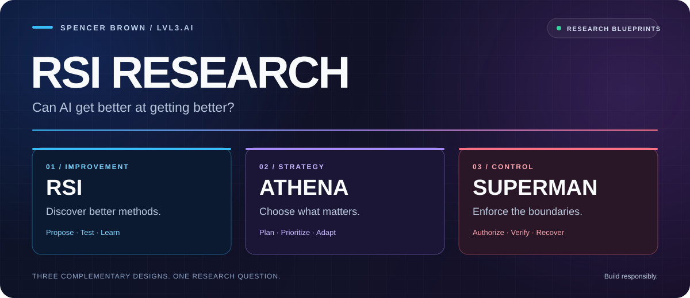
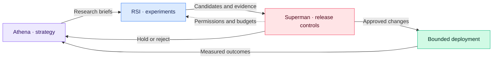

<p align="center">
  
</p>

<p align="center">
  <strong>Improve the engine. Choose the direction. Enforce the boundaries.</strong>
</p>

<p align="center">
  <a href="docs/RSI_PRD_V3.md">🔵 Read RSI v3</a> &nbsp; · &nbsp;
  <a href="docs/athena/ATHENA_PRD_V3.md">🟣 Read Athena v3</a> &nbsp; · &nbsp;
  <a href="docs/superman/SUPERMAN_PRD_V3.md">🔴 Read Superman v3</a>
</p>

<p align="center">
  <a href="https://github.com/SpencerBrown1717/RSI_research/raw/refs/heads/main/downloads/RSI_Research_V3_PRDs.zip"><strong>⬇️ Download all three PRDs (.zip)</strong></a>
</p>

# RSI Research

**Can AI get better at getting better—and remain under human control?**

Research by **Spencer Brown · LVL3.AI**. This repository publishes the matched **v3.0 · Fable Max Remake** product requirements documents (PRDs) for recursive self-improvement, long-horizon strategy, and independently enforced controls.

The proposed feedback loop connects **what to improve**, **how to improve it**, and **which changes may be adopted**.

> **Research status:** These are architecture and build specifications. Their performance figures are proposed targets, conditional bounds, or described reference-model results. This repository publishes the PRDs; it does not supply a runnable integrated system or demonstrate its real-world performance.

## ⬇️ Download the PRDs

**[Download all three v3 PRDs in one ZIP](https://github.com/SpencerBrown1717/RSI_research/raw/refs/heads/main/downloads/RSI_Research_V3_PRDs.zip)**

| Individual downloads | Format |
| :--- | :--- |
| [🔵 RSI v3](https://github.com/SpencerBrown1717/RSI_research/raw/refs/heads/main/downloads/RSI_PRD_V3.zip) | ZIP containing the original Markdown document |
| [🟣 Athena v3](https://github.com/SpencerBrown1717/RSI_research/raw/refs/heads/main/downloads/ATHENA_PRD_V3.zip) | ZIP containing the original Markdown document |
| [🔴 Superman v3](https://github.com/SpencerBrown1717/RSI_research/raw/refs/heads/main/downloads/SUPERMAN_PRD_V3.zip) | ZIP containing the original Markdown document |

Unzip the download, then open the `.md` files in any text or Markdown editor. All archives preserve the published v3 documents exactly; the combined ZIP also preserves their `docs/` directory paths.

## 📚 The three blueprints

| Blueprint | Role in the proposed system | Read the specification |
| :--- | :--- | :--- |
| 🔵 **RSI Fabric — the engine** | Generate and evaluate candidate improvements; measure capability production, research efficiency, and governed growth. | [Exponential Improvement Fabric · v3.0](docs/RSI_PRD_V3.md) |
| 🟣 **Athena — the objective** | Specify long-horizon strategic rewards, survival constraints, delayed credit, and protection against objective drift. | [Long-Horizon Strategic Intelligence · v3.0](docs/athena/ATHENA_PRD_V3.md) |
| 🔴 **Superman — the control layer** | Bound the engine and its objective through independent verification, permissions, budgets, pace monitoring, and stop controls. | [Containment, Control & Sun Mode · v3.0](docs/superman/SUPERMAN_PRD_V3.md) |

**Use this v3 trio together.** The documents identify one another as companion specifications. RSI v3 replaces the earlier v2 working specification; Athena v3 defines the newer reward kernel within the v5.1 architectural program; Superman v3 replaces the earlier v1 containment specification. Version numbers belong to each document's lineage, so Athena's older v5.1 master and its newer v3 reward specification should not be ranked by number alone.

## 🔄 How they fit together



*Conceptual integration:* independent evaluation supplies evidence for a release decision. Superman's controls also apply before and during execution. The diagram summarizes the intended interfaces; it does not establish that the combined system has been implemented or validated.

## 🧭 Where to start

| If you want to… | Start here |
| :--- | :--- |
| Understand the shared design | Each PRD's **program on one page**, then **Superman Section 2** |
| Build a small experiment loop | **RSI:** Sections 26–27, then the M0 success criteria in Section 47 |
| Examine the growth law, evaluation, and limits | **RSI:** Sections 64–68 and 72–73 |
| Review long-term objectives and reward integrity | **Athena:** Sections 1–12, then 42–48 |
| Review controls, acceptance, and delivery | **Superman:** Sections 3–10 and 17–23 |

The three files under `docs/` retain their source content and directory paths unchanged. Historical references are retained for lineage. Companion materials named in the PRDs—including Superman's Part III paper, reference models, earlier specifications, Sideways, and Ladder—are not bundled in this three-document publication.

## 🛠️ Build with an AI coding agent

Give your coding agent all three documents as source context, then begin with a bounded implementation brief:

```text
Read the RSI, Athena, and Superman PRDs together.
Summarize their shared interfaces and flag conflicting requirements.

Propose the smallest testable slice:
one improvement brief, one isolated experiment, independent evaluation,
a recorded result, and a human-reviewed release decision.

Implement in stages with explicit permissions, a fixed budget,
reproducible tests, and a rollback path.
Distinguish implemented behavior from targets and future work.
```

Loading the documents gives an agent design context. The evaluation and enforcement mechanisms must still be built and tested.

## 💬 Questions, critiques, and experiments

Useful feedback identifies a specific section, an assumption to challenge, a conflicting interface, or a reproducible experiment. If you implement a part of the design, share the baseline, resource budget, results, and limitations.

[Open an issue](https://github.com/SpencerBrown1717/RSI_research/issues/new) · [Browse the documents](docs/)

---

**Read critically. Test carefully. Build responsibly.**
